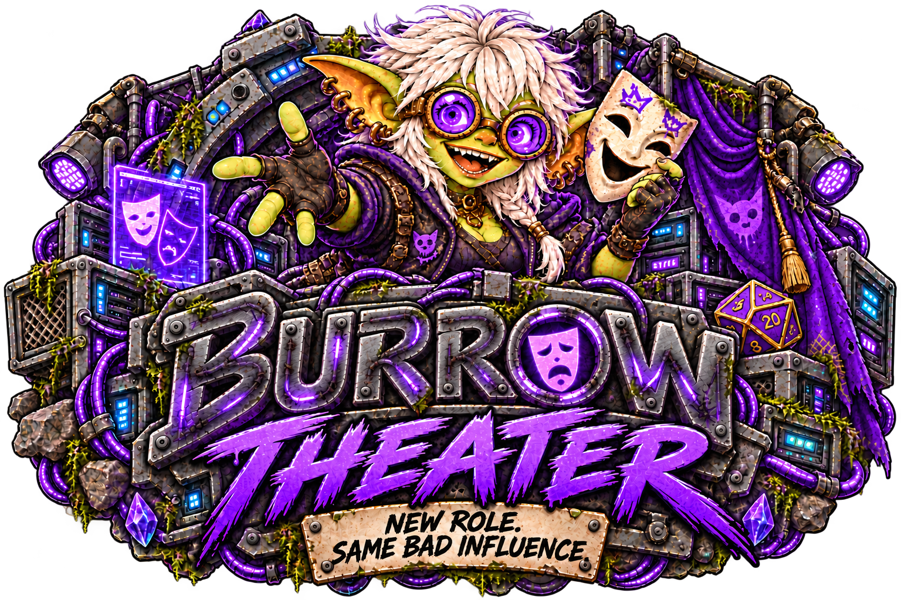

<p align="center">
  
</p>

# Burrow Theater

**New role. Same bad influence.**

Burrow Theater is an optional lightweight roleplay mod that keeps Burrow's familiar conversation experience while removing the operational machinery.

A Theater conversation is deliberately small:

```text
SOUL role + conversation transcript → selected text model → reply
```

The role is defined with the same SOUL-style Markdown used by Burrow agents. Theater does not provide tools, workspace context, task state, Brains, handoffs, subagents, or runtime-proof behavior. It uses Core's configured text models directly with `tools: null` and stores its roles and conversations only in the mod's Core-namespaced settings.

## Current experience

- Familiar Burrow-style chat and composer
- Reusable SOUL roles managed through Burrow Settings
- Optional Forge images enabled independently for each role when Core has an image model available
- Configured model selection, including local text-only models
- Persistent isolated conversations with immediate operator-message feedback while replies generate
- Explicit fiction boundary with no operational agent behavior
- Responsive desktop and mobile layouts

## Development

Requires Node.js 22.13+ and a sibling `Burrow-Backend` checkout for the Core contract test.

```sh
npm run build
npm test
```

Install through **Settings → Mods → Mod sources**:

1. Add `https://github.com/GoblinKing-Burrow/Burrow-Theater.git`.
2. Refresh and install a tagged version.
3. Explicitly enable the mod.

Burrow Theater is distributed under the [Burrow Sustainable Use License](LICENSE).
